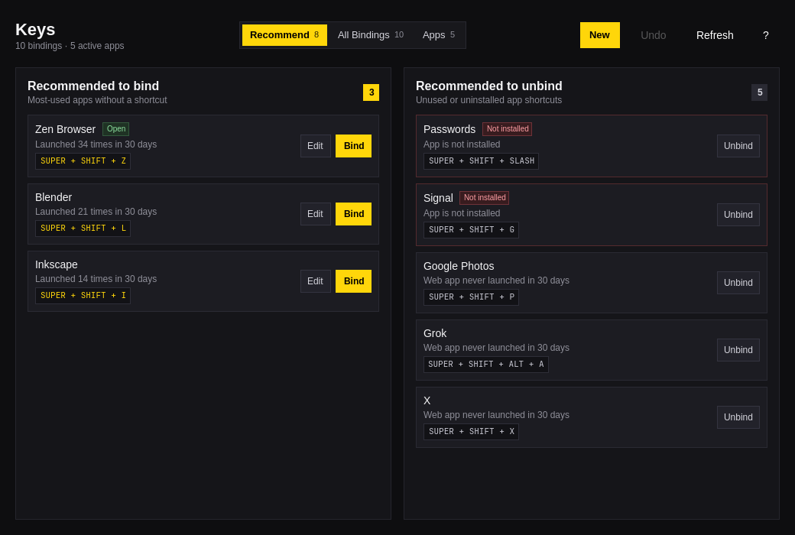

# Keys



A native Omarchy desktop app for managing Hyprland keybindings with smart **bind** and **unbind** recommendations.

Keys scans your active Hyprland bindings alongside your recent application launch history (last 30 days) and open windows to highlight:

- **Recommended to bind:** Your most-used apps that don't have a shortcut yet, paired with a conflict-free suggested key combo.
- **Recommended to unbind:** Preinstalled or custom app shortcuts whose apps aren't installed or haven't been launched in 30 days.
- **All Bindings & Apps:** Search every active shortcut (`super s`, `scratchpad`, etc.) to rebind or unbind, or browse and search all installed desktop apps to assign shortcuts with an interactive key recorder.
- **Safe edits:** All changes are written atomically inside a delimited `-- >>> keys-managed` block in `~/.config/hypr/bindings.lua` with a session backup, `hyprctl configerrors` validation (with automatic rollback on error), and full Undo/Redo.
- **Omarchy native:** Follows your Omarchy accent color, Hyprland corner rounding, and Omarchy language live (English, Danish, Spanish).

## Install on Omarchy

### From the AUR *(once published)*

```sh
omarchy pkg aur add omarchy-keys
```

### From GitHub Releases (precompiled Arch package)

Download `keys-0.1.0-1-x86_64.pkg.tar.zst` from the [latest release](https://github.com/Mojarras7/omarchy-keys/releases/latest) and install it:

```sh
sudo pacman -U keys-0.1.0-1-x86_64.pkg.tar.zst
```

### From source

```sh
git clone https://github.com/Mojarras7/omarchy-keys.git
cd keys
./bin/install
```

After installing, open **Keys** from the Omarchy app launcher (`Super + Space`).

## Keyboard Shortcuts

| Shortcut | Action |
| --- | --- |
| `1` / `2` / `3` | Switch between Recommend, All Bindings, and Apps |
| `/` | Search bindings or installed apps |
| `N` | Add a new custom shortcut |
| `Space` | Refresh usage scan |
| `Ctrl+Z` / `Ctrl+Shift+Z` | Undo / Redo |
| `?` | Toggle shortcut help overlay |
| `Q` | Quit |

## CLI

Keys also supports headless JSON output for scripts and agents:

```sh
keys scan --json   # Usage stats, bind recommendations, and unbind recommendations
keys list --json   # Active bindings and unbound overrides
```

## Development

```sh
./bin/build     # Compile to build/keys
./bin/test      # Run the Qt Test suite offscreen
./bin/install   # Package and install with makepkg -fsi
```

## License

MIT — see [LICENSE](LICENSE).
